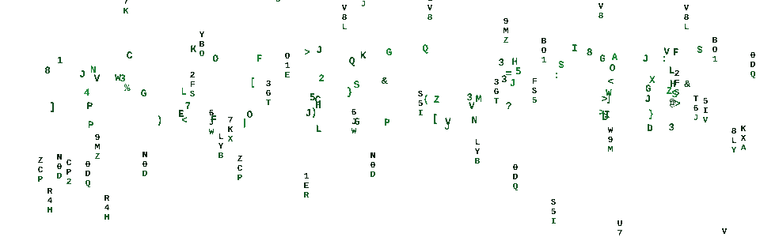
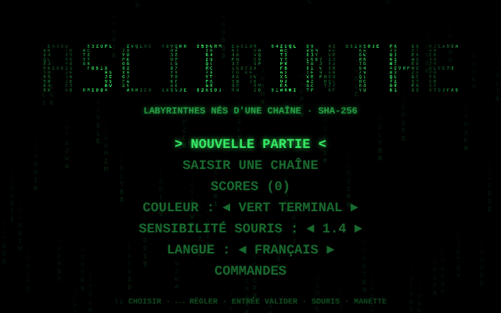
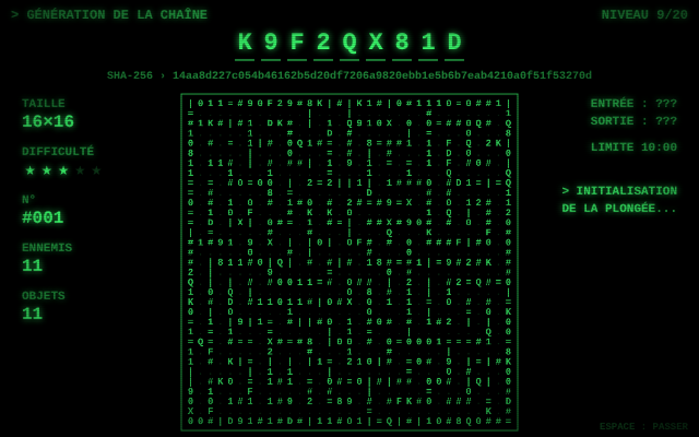
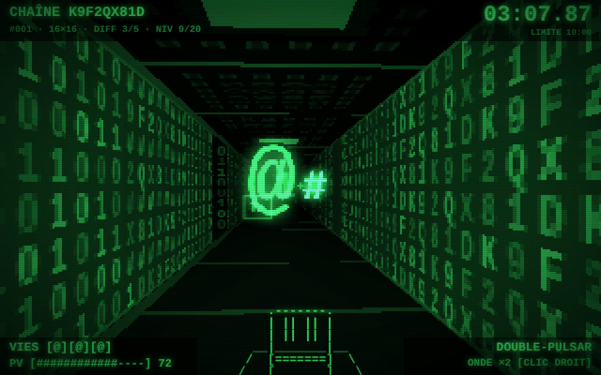
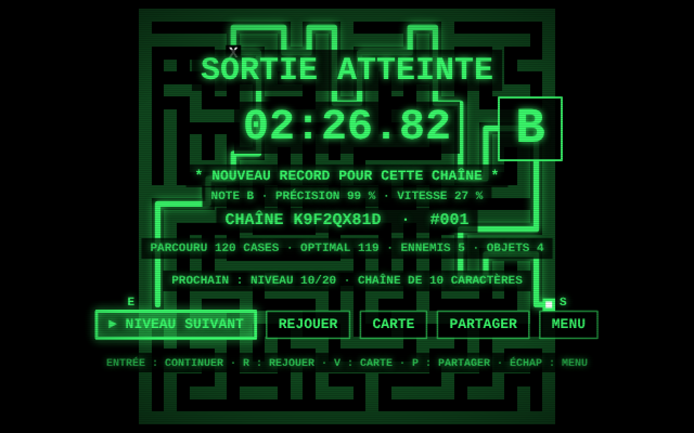

  

  <b>Chaque chaîne de caractères cache un labyrinthe. Trouveras-tu la sortie ?</b> 
  <i>Every string hides a maze. Can you find the exit?</i>

  <a href="https://damballah.itch.io/asciirinthe" target="_blank" ><b>▶ JOUER / PLAY — damballah.itch.io/asciirinthe</b></a>

  <a href="#-français">🇫🇷 Français</a> · <a href="#-english">🇬🇧 English</a>

## 📸 Captures d'écran · Screenshots

<table>
  <tr>
    <td align="center" width="50%">
       
      <b>Menu principal</b> · <i>Main menu</i>
    </td>
    <td align="center" width="50%">
       
      <b>Une chaîne devient un labyrinthe</b> · <i>A string becomes a maze</i>
    </td>
  </tr>
  <tr>
    <td align="center" width="50%">
       
      <b>En jeu, à la première personne</b> · <i>In game, first person</i>
    </td>
    <td align="center" width="50%">
       
      <b>Fin de niveau : note et parcours</b> · <i>Level complete: grade and route</i>
    </td>
  </tr>
</table>

---

## 🇫🇷 Français

**ASCIIRINTHE** est un FPS rétro d'exploration de labyrinthe, entièrement dessiné en caractères ASCII, dans l'ambiance d'un vieux terminal monochrome.

Tape une chaîne de **1 à 20 caractères** (lettres A-Z et chiffres 0-9) : le jeu calcule son empreinte **SHA-256** et en tire un labyrinthe unique. La vue plonge ensuite du plan vu de dessus jusqu'à l'entrée, et tu te retrouves dedans, à la première personne, avec **10 minutes pour trouver la sortie**.

### Plus de labyrinthes que de grains de sable sur Terre

Il existe plus de **1,3 × 10³¹** chaînes possibles, soit environ **2 000 milliards de fois** le nombre estimé de grains de sable sur Terre (≈ 7,5 × 10¹⁸).
Et pourtant, **la même chaîne donne toujours exactement le même labyrinthe**, sur n'importe quel appareil : partage ta chaîne et défie tes amis sur le même parcours.

### Fonctionnalités

- 🧭 **Campagne de 20 niveaux** : du niveau 1 (1 caractère, 8×8) au niveau 20 (20 caractères, 27×27).
- ♾️ **Mode libre infini** : n'importe quelle chaîne devient un niveau.
- 👾 **Ennemis faits de caractères** : les lettres de la chaîne, des `@` rapides, des colosses `&`. Certains tirent des `/` qu'on peut esquiver ou abattre.
- ✴️ **Armes à étoiles `*`**, onde de choc, soins, vies, bonus de temps et deux cartes à trouver.
- ✨ **Traînée lumineuse** au sol et **indice caché** avant la sortie.
- 🔊 **Son 100 % généré en direct** (Web Audio), de plus en plus oppressant au fil des minutes.
- 🏆 **Note de S à D** (vitesse + précision du trajet), parcours affiché sur la carte, **tableau des scores** daté.
- 📤 **Carte de score à partager** avec QR code, sans jamais dévoiler le chemin.
- 🎨 **8 couleurs d'écran** : vert, ambre, bleu, rose, jaune, blanc, gris, violet.
- 🌍 **Français / anglais**.
- 🎮 **Clavier + souris, manette et écran tactile** (mobile et tablette).

### Commandes

| Action | Clavier / souris | Manette | Tactile |
|---|---|---|---|
| Se déplacer | ZQSD / WASD / ↑↓ (Maj = courir) | Stick gauche | Joystick (pouce gauche) |
| Viser | Souris (360° + haut/bas) | Stick droit | Glisser le pouce droit |
| Tirer | Clic gauche / Espace | RT ou A | Bouton `*` |
| Onde de choc | Clic droit / E / F | LT ou B | Bouton ONDE |
| Pause | Échap / P | START | Bouton `||` |

### Comment ça marche

1. La chaîne est normalisée (majuscules, lettres et chiffres uniquement), puis hachée en **SHA-256**.
2. Les 256 bits servent de graine à deux générateurs pseudo-aléatoires déterministes (**sfc32**) : l'un pour les murs, l'autre pour les ennemis et les objets.
3. Le labyrinthe est creusé par **backtracking récursif** (longs couloirs, impasses), puis quelques murs sont ouverts pour créer **plusieurs chemins**. La sortie est placée sur la case du bord la plus éloignée de l'entrée.
4. La vue 3D est un **raycaster** à la Wolfenstein 3D : les murs, le sol et le plafond sont des textures de caractères, rendues en basse résolution pour le côté pixelisé.

Le SHA-256, le générateur de QR code et la police du titre sont codés à la main : **aucune dépendance, aucun serveur, aucune connexion requise**.

### Lancer le jeu

- **En ligne** : [damballah.itch.io/asciirinthe](https://damballah.itch.io/asciirinthe)
- **En local** : ouvre simplement `index.html` dans un navigateur récent (Chrome, Firefox, Edge, Safari).
- **GitHub Pages** : active Pages sur la branche principale, le jeu est servi tel quel.

Les scores et réglages sont enregistrés dans le navigateur (`localStorage`), sur ton appareil uniquement.

### Crédits

Conçu par **Damballah**, et développé avec l'aide de **Claude**, l'IA d'Anthropic.
[itch.io](https://damballah.itch.io/asciirinthe) · [Twitch](https://www.twitch.tv/damballahretro)

---

## 🇬🇧 English

**ASCIIRINTHE** is a retro first-person maze shooter, drawn entirely with ASCII characters in the style of an old monochrome terminal.

Type a string of **1 to 20 characters** (letters A-Z and digits 0-9): the game computes its **SHA-256** hash and turns it into a unique maze. The view then dives from the top-down map into the entrance, and you're inside, in first person, with **10 minutes to find the exit**.

### More mazes than grains of sand on Earth

There are more than **1.3 × 10³¹** possible strings, roughly **2 trillion times** the estimated number of grains of sand on Earth (≈ 7.5 × 10¹⁸).
Yet **the same string always gives exactly the same maze**, on any device: share your string and challenge your friends on the same layout.

### Features

- 🧭 **20-level campaign**: from level 1 (1 character, 8×8) to level 20 (20 characters, 27×27).
- ♾️ **Endless free mode**: any string becomes a level.
- 👾 **Enemies made of characters**: the letters of your string, fast `@`, heavy `&`. Some shoot `/` that you can dodge or shoot down.
- ✴️ **Star `*` weapons**, shockwave, heals, lives, time bonuses and two maps to find.
- ✨ **Glowing trail** on the floor and a **hidden clue** before the exit.
- 🔊 **Fully procedural sound** (Web Audio) that grows more oppressive as time runs out.
- 🏆 **S to D grade** (speed + path accuracy), your route shown on the map, dated **score table**.
- 📤 **Shareable score card** with a QR code, never revealing the path.
- 🎨 **8 screen colors**: green, amber, blue, pink, yellow, white, grey, purple.
- 🌍 **French / English**.
- 🎮 **Keyboard + mouse, gamepad and touchscreen** (phones and tablets).

### Controls

| Action | Keyboard / mouse | Gamepad | Touch |
|---|---|---|---|
| Move | WASD / ZQSD / ↑↓ (Shift = run) | Left stick | Joystick (left thumb) |
| Aim | Mouse (360° + up/down) | Right stick | Slide right thumb |
| Fire | Left click / Space | RT or A | `*` button |
| Shockwave | Right click / E / F | LT or B | WAVE button |
| Pause | Esc / P | START | `||` button |

### How it works

1. The string is normalized (uppercase, letters and digits only), then hashed with **SHA-256**.
2. The 256 bits seed two deterministic pseudo-random generators (**sfc32**): one for the walls, one for enemies and items.
3. The maze is carved with a **recursive backtracker** (long corridors, dead ends), then a few walls are opened to create **multiple paths**. The exit is placed on the border cell farthest from the entrance.
4. The 3D view is a Wolfenstein-style **raycaster**: walls, floor and ceiling are character textures, rendered at low resolution for that pixelated look.

SHA-256, the QR code generator and the title font are all hand-written: **no dependencies, no server, no connection required**.

### Run it

- **Online**: [damballah.itch.io/asciirinthe](https://damballah.itch.io/asciirinthe)
- **Locally**: just open `index.html` in a modern browser (Chrome, Firefox, Edge, Safari).
- **GitHub Pages**: enable Pages on the main branch, the game is served as is.

Scores and settings are stored in your browser (`localStorage`), on your device only.

### Credits

Designed by **Damballah**, developed with the help of **Claude**, Anthropic's AI.
[itch.io](https://damballah.itch.io/asciirinthe) · [Twitch](https://www.twitch.tv/damballahretro)
